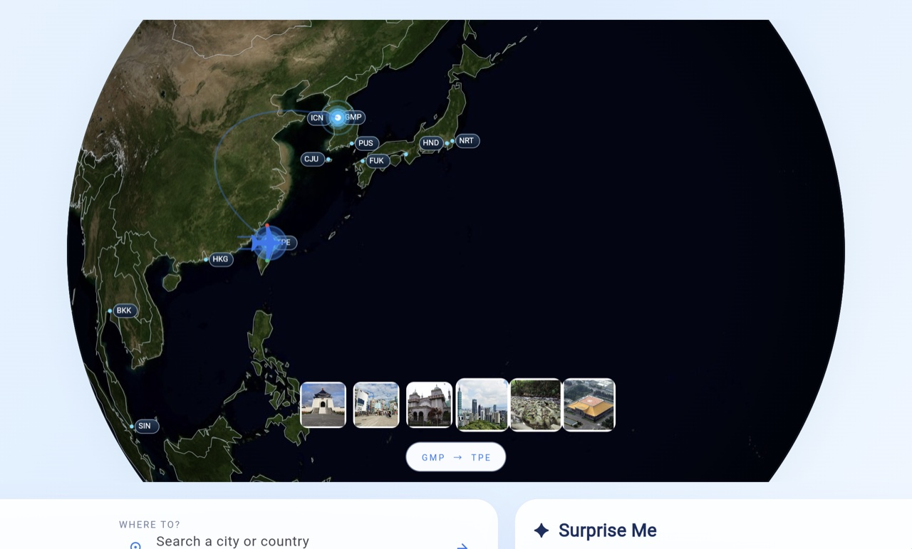
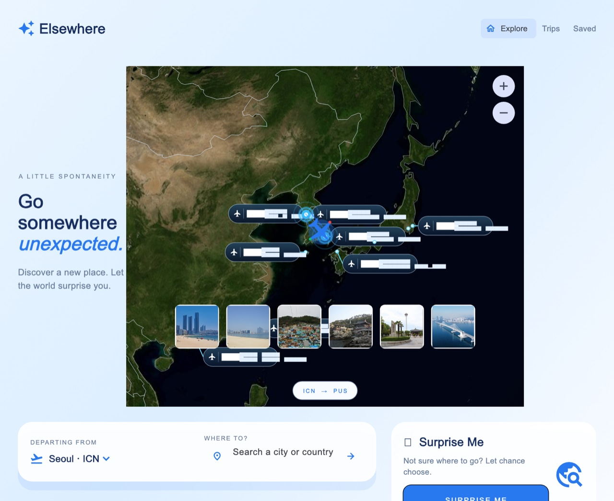
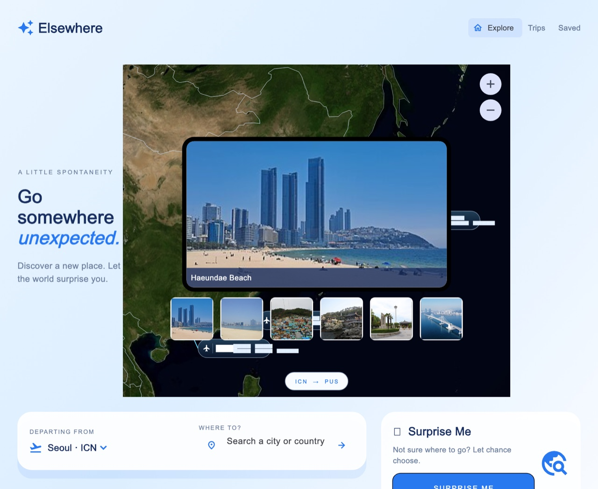

# Elsewhere

A spontaneous travel app for iOS, Android, and web. Pick a departure airport, tap **Surprise Me**, and follow the flight across an interactive 3D globe.



## Landmark preview

The gallery appears on the globe after arrival. Hover over a thumbnail to enlarge it, or tap to pin the preview.

| Thumbnails | Expanded on hover |
| --- | --- |
|  |  |

## Run locally

```sh
flutter pub get
flutter run
```

For web, run `flutter run -d web-server` and open the printed URL in your browser. Sample mode needs no account or API key.

## Explore

- Allow location access to find the nearest airport in the catalog, or search 52 departure airports by partial city, country, or IATA code.
- Search for a destination to open a sample preview, or use **Surprise Me** to animate a random route. Hover over a landmark thumbnail for a larger preview. Click or tap to pin it, and tap again to close it.
- Drag the globe horizontally to rotate while keeping north up. Use the wheel, pinch, or zoom buttons. Country boundaries and airport labels gain detail as you zoom.
- At 2.8× zoom, the globe loads OpenStreetMap tiles for the current view and fades into an interactive map. Zoom out or use **Back to globe** to return. **Open Google Maps** opens the same location externally. For another licensed tile provider, pass `--dart-define=OSM_TILE_URL=https://your-host/{z}/{x}/{y}.png`.
- The layout adapts to the available width and keeps content clear of a reported foldable hinge.

## Live fares

Deploy the Cloudflare Worker in `worker/` and configure a live Duffel token:

```sh
cd worker
npx wrangler secret put DUFFEL_TOKEN
npx wrangler deploy
cd ..
flutter run --dart-define=FLIGHTS_API_URL=https://your-worker.example.workers.dev
```

**Surprise Me** looks for departures within 12 hours and a three-day round trip. The Worker caches route searches at the Cloudflare edge for up to two minutes. Its live fare allowlist currently covers 16 airports. The larger departure catalog also supports sample previews. If no fare is returned, the app shows a sample destination without a price.

## Checks and credits

```sh
flutter analyze
flutter test
```

Earth imagery is NASA Blue Marble. Country outlines use public domain Natural Earth data from TerraNewsphere. Landmark photos are from Wikimedia Commons, with source and license in the result card.

Before store release, replace the starter icons and app IDs, add a privacy policy URL, confirm provider terms, and test on physical devices.
